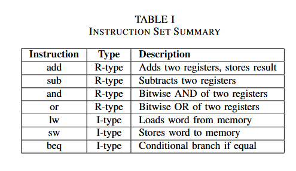
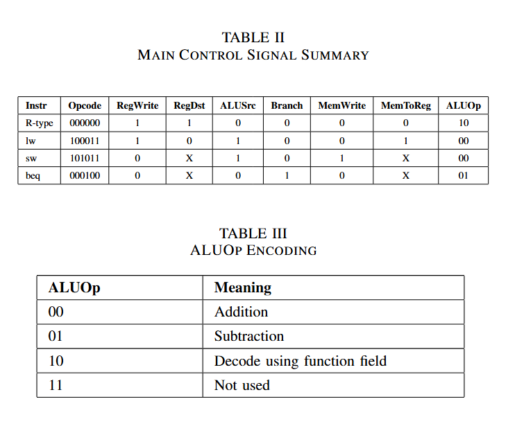
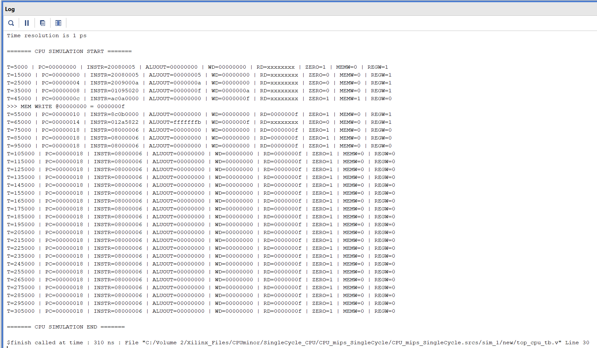
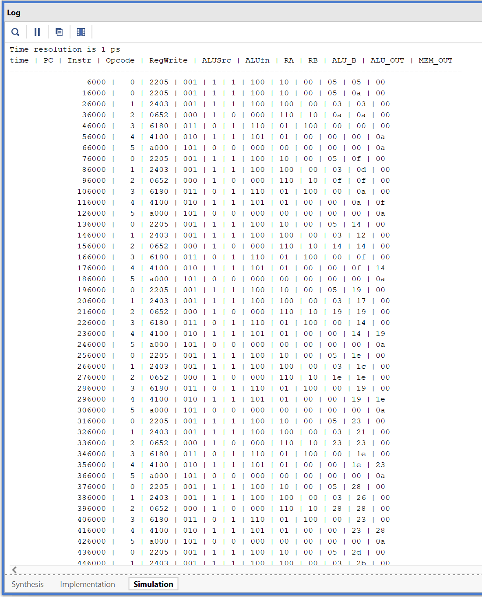

<div align="center">

# MIPS Single-Cycle Processors

### 8-bit and 32-bit CPU Design using Verilog HDL

<p>
  
  
  
  
</p>

**A modular RTL project exploring processor datapaths, control logic, instruction execution, and simulation through two MIPS-style single-cycle CPU implementations.**

</div>

---

## Overview

This repository contains two educational CPU implementations built with **Verilog HDL**:

- **8-bit single-cycle processor** — a compact design for exploring the fundamental building blocks of a CPU.
- **32-bit single-cycle processor** — a wider MIPS-style datapath with dedicated modules for instruction decoding, ALU control, registers, memories, and datapath operations.

The project is organized into separate RTL and testbench directories, with supporting architecture references, instruction-format diagrams, control tables, and simulation logs.

> **Scope:** The instruction summary currently documented for the 32-bit processor includes `add`, `sub`, `and`, `or`, `lw`, `sw`, and `beq`. Check the RTL and testbenches for the exact behavior supported by each implementation.

## At a glance

| | 8-bit CPU | 32-bit CPU |
|---|---|---|
| RTL language | Verilog HDL | Verilog HDL |
| Design style | Single-cycle | Single-cycle |
| Main components | ALU, control, PC, register file, instruction and data memories | ALU, control decoders, PC, register file, datapath, instruction and data memories |
| Verification assets | Testbenches and simulation log | Module-level and top-level testbenches, simulation log |
| Main purpose | Learn and explore CPU fundamentals | Explore a modular MIPS-style datapath and control unit |

## Repository layout

```text
.
├── MIPS_cpu_32bit_singlecycle/
│   ├── rtl/                         # 32-bit processor RTL modules
│   └── testbench/                   # Top-level and module-level testbenches
│       └── tb_modulewise/
│
├── MIPS_cpu_8bit_singlecycle/
│   ├── rtl/                         # 8-bit processor RTL modules
│   ├── testbench/                   # CPU testbenches
│   └── imem.hex                     # Instruction program, if used by the design
│
├── docs/
│   ├── images/                      # Diagrams, control tables and simulation logs
│   └── references/                  # Architecture and instruction-format references
│
└── README.md
```

*This is a high-level overview. Refer to the directories in the repository for the exact module and file names.*

## Processor architecture

### 32-bit processor

The 32-bit design separates key CPU functions into Verilog modules. The intended single-cycle instruction path is:

1. **Fetch** — the program counter selects an instruction from instruction memory.
2. **Decode** — the control logic interprets the opcode and, for R-type operations, the function field.
3. **Read operands** — the register file supplies source-register values.
4. **Execute** — the ALU performs arithmetic, logical, address-calculation, or comparison operations.
5. **Memory access** — load and store instructions interact with data memory.
6. **Write-back / next PC** — results are written to the register file when required, and the PC advances or branches according to the instruction.

The stages describe the conceptual data flow; the implementation combines them within one clock cycle rather than using a multi-stage pipeline.

**Architecture reference:** See `docs/references/architecture_32bit.pdf`.

### 8-bit processor

The 8-bit implementation provides a smaller design for examining the same core concepts: instruction fetch, control, register operations, ALU execution, and memory interaction.

**Architecture reference:** See `docs/references/architecture_8bit.pdf`.

## Instruction set and control logic

The following instruction subset is documented for the 32-bit design.

| Instruction | Format | Function |
|---|---|---|
| `add` | R-type | Add two register operands |
| `sub` | R-type | Subtract one register operand from another |
| `and` | R-type | Bitwise AND |
| `or` | R-type | Bitwise OR |
| `lw` | I-type | Load a word from data memory |
| `sw` | I-type | Store a word to data memory |
| `beq` | I-type | Branch when the compared operands are equal |

### Instruction set summary



### Main control signals

The main control decoder generates control signals such as `RegWrite`, `RegDst`, `ALUSrc`, `Branch`, `MemWrite`, `MemToReg`, and `ALUOp`, according to the instruction opcode.



### ALU control decoder

The ALU control decoder uses `ALUOp` and, where applicable, the R-type function field to select an ALU operation.


For the complete diagrams and instruction encodings, see the reference files:

- `docs/references/instr_format_rtype.pdf`
- `docs/references/instr_format_itype.pdf`
- `docs/references/instr_format_jtype.pdf`

## Simulation

The repository includes simulation transcripts from the two CPU implementations. These logs help inspect the program counter, instruction words, ALU results, register writes, and memory activity.

### 32-bit processor simulation



### 8-bit processor simulation



> Simulation logs demonstrate observed behavior for the program and testbench that were run. They do not, on their own, establish complete verification of every instruction or corner case.

## Run the simulation

The following workflow is intended for **Xilinx Vivado**. Exact menu labels may vary by version.

1. Clone or download this repository.
2. Open Vivado and create an RTL project for the processor you want to test.
3. Add the Verilog source files from that processor's `rtl/` directory.
4. Add the corresponding testbench files from its `testbench/` directory as simulation sources.
5. Set the appropriate testbench module as the simulation top.
6. Run **Behavioral Simulation**.
7. Inspect the waveform and simulation console output.
8. Compare the observed results with the expected results defined by the testbench.

### Important setup notes

- Test the 8-bit and 32-bit designs in separate project source sets.
- If a design uses an initialization file such as `imem.hex`, make sure Vivado can locate it during simulation.
- Check the testbench for the expected clock, reset/initialization sequence, and simulation duration.
- If Vivado reports that a module cannot be found, confirm that the relevant RTL file has been added and that its module name matches the instantiation.
- If a testbench only prints values, consider adding assertions so mismatches cause a clear simulation failure.

## RTL modules

The 32-bit RTL directory includes modules for several common CPU building blocks, including:

| Module / file | Responsibility |
|---|---|
| `cpu_top.v` | Top-level CPU integration |
| `datapath.v` | Connects the datapath components |
| `pc.v` | Program-counter logic |
| `register_file.v` | Register storage and access |
| `alu.v` | Arithmetic and logical operations |
| `main_control_dec.v` | Main instruction control decoding |
| `alu_control_dec.v` | ALU operation decoding |
| `instruction_memory.v` | Instruction storage / retrieval |
| `data_memory.v` | Data-memory read and write logic |
| `sign_extend.v` | Extends immediate values |
| `mux2x1.v` | Selects between two input values |
| `adder.v` | Addition logic |
| `left_shift_2.v` | Shift-left-by-two logic |

Use the RTL source as the definitive reference for each module's actual interface and behavior.

## Tools and technologies

- **Verilog HDL** — hardware description and RTL design
- **Xilinx Vivado** — project management and simulation
- **Git / GitHub** — source control and project collaboration

## Future improvements

Potential next steps for strengthening the project:

- Add self-checking testbenches with explicit pass/fail results.
- Test arithmetic, logical, load/store, and branch behavior individually.
- Document reset and memory initialization behavior.
- Add representative waveforms alongside console logs.
- Include example programs and expected results for each CPU.
- Document limitations and any instruction-set differences between the two designs.

These are suggested improvements, not claims that every item is already implemented.

## Learning objectives

This project provides hands-on practice with:

- CPU datapath and control-unit organization
- Instruction formats and opcode/function decoding
- ALU design and operation selection
- Program counters, register files, and memory interfaces
- Modular Verilog design and module instantiation
- Testbench creation and simulation-based debugging
- Reading simulation output to understand instruction execution

## GitHub topics

Suggested repository topics:

`verilog` · `mips` · `cpu-design` · `single-cycle-cpu` · `computer-architecture` · `rtl-design` · `digital-design` · `xilinx-vivado` · `hardware-design` · `8-bit-cpu` · `32-bit-cpu`

## License

No license is specified in this README. If you want others to reuse, modify, or distribute this project, select a license and add the corresponding `LICENSE` file. Make sure you have the right to license all included material.

---

<div align="center">

**Built to learn, simulate, and understand processor architecture.**

</div>
